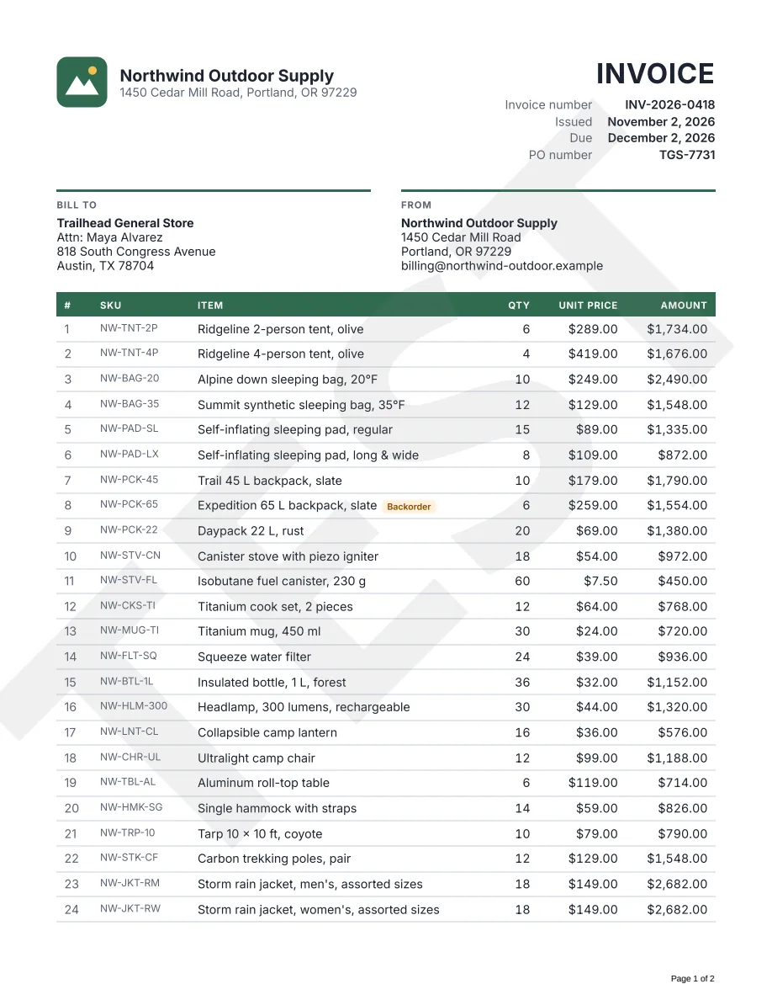
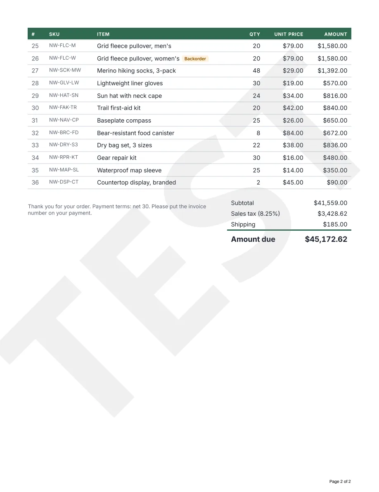
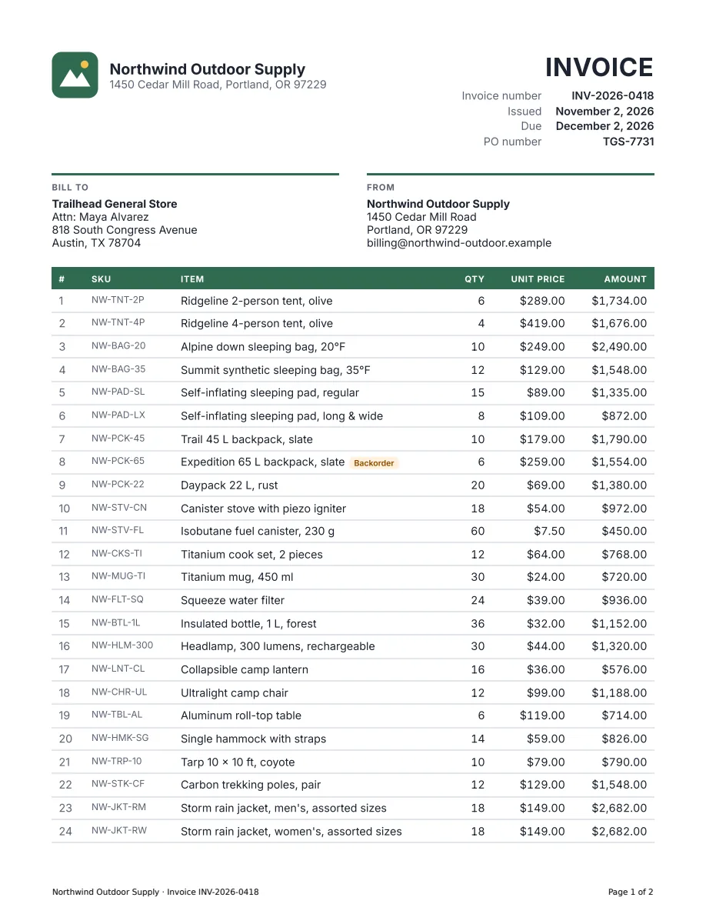
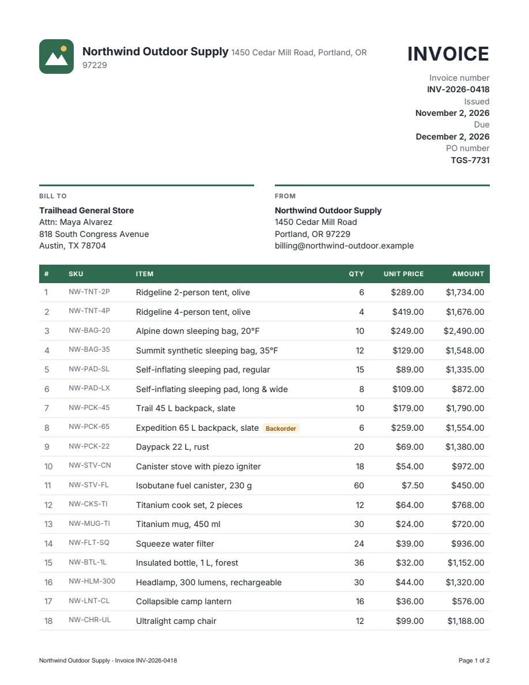
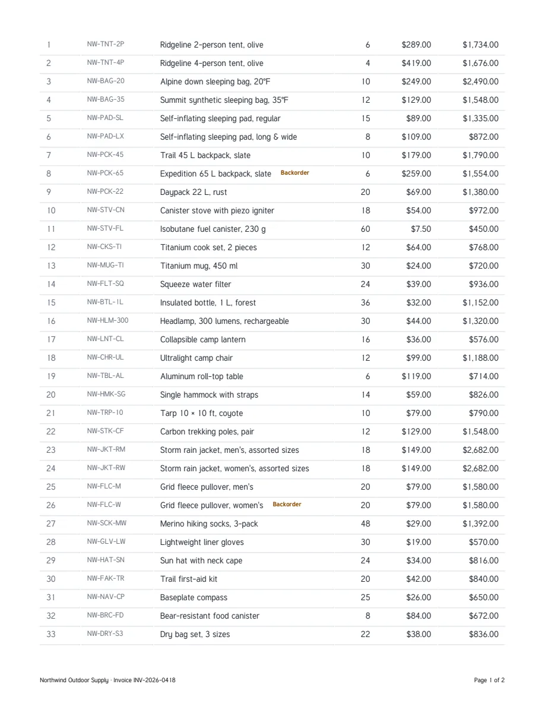
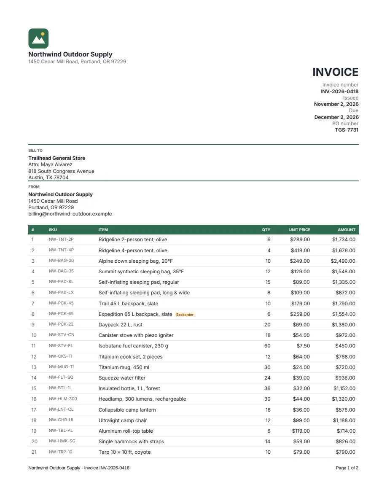

# HTML to PDF in C# and .NET: an invoice from a template or a Razor component

Render a two-page invoice from an HTML template and JSON data in C# with
[Dynamic Document API](https://dynamicdocumentapi.com/): a Flexbox header with an SVG logo, a web font, a line-item
table that repeats its header row on page 2, totals that stay together and "Page 1 of 2" in the footer. Plain
`HttpClient`, no SDK, .NET 10.

| Page 1 | Page 2 |
|---|---|
|  |  |

The step-by-step tutorial: **[HTML to PDF in C# and .NET](https://dynamicdocumentapi.com/docs/tutorials/html-to-pdf-csharp)**.

## Run it

You need the [.NET 10 SDK](https://dotnet.microsoft.com/download) and an API key. Create one under **API keys** at
[app.dynamicdocumentapi.com](https://app.dynamicdocumentapi.com/signup) (free plan, no credit card). A test key
(`dda_test_…`) renders free PDFs with a TEST watermark.

```bash
export DYNAMIC_DOCUMENT_API_KEY="dda_test_..."

dotnet run --project src/RenderInvoice         # template + JSON data, the API fills it -> invoice.pdf
dotnet run --project src/RenderRazorInvoice    # a Razor component renders the HTML in .NET -> invoice-razor.pdf
dotnet run --project src/InvoiceApi            # ASP.NET Core: http://localhost:5000/invoices/INV-2026-0418.pdf
```

[`docs/example-invoice.pdf`](docs/example-invoice.pdf) is the output of a test key.

## Files

| File | What it is |
|---|---|
| `invoice/invoice.html` | The template: HTML and CSS with placeholders, a loop over the line items, a condition and `"{:,.2f}".format()` for money. The API fills it |
| `invoice/invoice.json` | An invented invoice with 36 line items |
| `src/Invoices/Invoice.cs` | Loads the JSON and calculates line amounts, sales tax and totals with `decimal` |
| `src/Invoices/InvoiceDocument.razor` | The same invoice as a Razor component, with C# instead of template placeholders |
| `src/Invoices/InvoiceHtml.cs` | Renders the component to an HTML string with .NET's `HtmlRenderer`, outside of a web app |
| `src/RenderInvoice` | Sends template, data and page settings with `HttpClient` and saves the PDF |
| `src/RenderRazorInvoice` | Sends the finished HTML from the Razor component instead |
| `src/InvoiceApi` | An ASP.NET Core endpoint that streams the PDF to the browser: typed `HttpClient`, timeouts and retries from `Microsoft.Extensions.Http.Resilience`, an idempotency key |
| `compare/` | The same invoice through PuppeteerSharp, iText pdfHTML, HtmlRenderer.PdfSharp and DinkToPdf |

## Library comparison

[`compare/Compare`](compare/Compare/Renderers.cs) renders the invoice with four .NET libraries, each with page numbers
added the way its documentation describes, and checks whether each one runs JavaScript. Every library gets the same
finished HTML from the Razor component. It runs in GitHub Actions on Ubuntu 24.04 with .NET 10
([workflow](.github/workflows/compare.yml)); no API key needed. Results from the last run, with versions, are in
[`compare/results`](compare/results):

| Page 1 | |
|---|---|
|  PuppeteerSharp 25.18 (Chrome 157): as designed |  iText pdfHTML 6.3.4: Flexbox and web font work, the invoice details (CSS grid) are stacked |
|  HtmlRenderer.PdfSharp 1.6.1: header, addresses and totals missing, no web font |  DinkToPdf 1.0.8 + wkhtmltopdf 0.12.6.1: Flexbox and grid ignored |

To run it yourself on Ubuntu: install `fonts-liberation` and the
[wkhtmltopdf 0.12.6.1 package](https://github.com/wkhtmltopdf/packaging/releases/tag/0.12.6.1-3), then
`dotnet run --project compare/Compare -c Release` and `pip install -r compare/requirements.txt && python compare/analyze.py`.
PuppeteerSharp downloads Chrome (about 720 MB) on the first run. On Ubuntu 23.10 and later Chrome only starts once its
sandbox is allowed, see the workflow.

## Learn more

- [Template language](https://dynamicdocumentapi.com/docs/template-language): loops, conditions, filters for dates and money
- [PDF options](https://dynamicdocumentapi.com/docs/pdf-options): paper, margins, metadata, waiting for scripts
- [Headers and footers](https://dynamicdocumentapi.com/docs/headers-and-footers): text mode or your own HTML, page numbers
- [Errors and retries](https://dynamicdocumentapi.com/docs/errors)
- [HTML to PDF API](https://dynamicdocumentapi.com/html-to-pdf-api/)

## License

MIT. The invoice data is invented. `compare/` uses iText pdfHTML, which is licensed under the AGPL or commercially;
it isn't part of the samples in `src/`.
